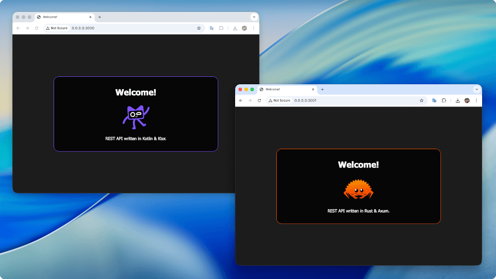

# Check performance

Language and frameworks REST API performance test.



### Frameworks

- Ktor (kotlin)
- Axum (rust)

### Install

- [rust](https://rust-lang.org/tools/install/)
- [java](https://ubuntu.com/toolchains/java)
- [k6](https://grafana.com/docs/k6/latest/set-up/install-k6/)
- [postgres](https://www.postgresql.org/download/)


### Run

**Ktor**

```shell
./scripts/run_ktor.sh
```

**Axum**

```shell
./scripts/run_axum.sh
```

**Tests**

```shell
./tests/run.sh
```

### Tests

**Ktor**

```shell
         /\      Grafana   /‾‾/  
    /\  /  \     |\  __   /  /   
   /  \/    \    | |/ /  /   ‾‾\ 
  /          \   |   (  |  (‾)  |
 / __________ \  |_|\_\  \_____/ 

     execution: local
        script: tests/run_all.js
 web dashboard: http://127.0.0.1:5665
        output: -

     scenarios: (100.00%) 4 scenarios, 20000 max VUs, 1m30s max duration (incl. graceful stop):
              * run_api: Up to 200000.00 iterations/s for 1m0s over 3 stages (maxVUs: 1000-5000, exec: run_api, gracefulStop: 30s)
              * run_auth: Up to 200000.00 iterations/s for 1m0s over 3 stages (maxVUs: 1000-5000, exec: run_auth, gracefulStop: 30s)
              * run_home: Up to 200000.00 iterations/s for 1m0s over 3 stages (maxVUs: 1000-5000, exec: run_home, gracefulStop: 30s)
              * run_user: Up to 200000.00 iterations/s for 1m0s over 3 stages (maxVUs: 1000-5000, exec: run_user, gracefulStop: 30s)


  █ TOTAL RESULTS 

    checks_total.......: 92101   1201.665775/s
    checks_succeeded...: 100.00% 92101 out of 92101
    checks_failed......: 0.00%   0 out of 92101

    ✓ http://0.0.0.0:3002: 200
    ✓ http://0.0.0.0:3002/api: 404
    ✓ http://0.0.0.0:3002/api/users/1: 403
    ✓ http://0.0.0.0:3002/api/auth: 200

    HTTP
    http_req_duration..............: avg=14.2s  min=196.35µs med=16.11s max=19.24s p(90)=17.67s p(95)=18.17s
      { expected_response:true }...: avg=14.24s min=271.11µs med=16.14s max=19.24s p(90)=17.69s p(95)=18.19s
    http_req_failed................: 50.15%   46197 out of 92101
    http_reqs......................: 92101    1201.665775/s

    EXECUTION
    dropped_iterations.............: 18300408 238770.197563/s
    iteration_duration.............: avg=14.2s  min=356.68µs med=16.11s max=19.24s p(90)=17.67s p(95)=18.18s
    iterations.....................: 92101    1201.665775/s
    vus............................: 622      min=622            max=20000
    vus_max........................: 20000    min=5160           max=20000

    NETWORK
    data_received..................: 44 MB    580 kB/s
    data_sent......................: 8.9 MB   117 kB/s


running (1m16.6s), 00000/20000 VUs, 92101 complete and 0 interrupted iterations
run_api  ✓ [======================================] 0000/5000 VUs  1m0s  199960.01 iters/s
run_auth ✓ [======================================] 0000/5000 VUs  1m0s  199960.01 iters/s
run_home ✓ [======================================] 0000/5000 VUs  1m0s  199960.01 iters/s
run_user ✓ [======================================] 0000/5000 VUs  1m0s  200000.00 iters/s
```

**Axum**

```shell
         /\      Grafana   /‾‾/  
    /\  /  \     |\  __   /  /   
   /  \/    \    | |/ /  /   ‾‾\ 
  /          \   |   (  |  (‾)  |
 / __________ \  |_|\_\  \_____/ 

     execution: local
        script: tests/run_all.js
 web dashboard: http://127.0.0.1:5665
        output: -

     scenarios: (100.00%) 4 scenarios, 20000 max VUs, 1m30s max duration (incl. graceful stop):
              * run_api: Up to 200000.00 iterations/s for 1m0s over 3 stages (maxVUs: 1000-5000, exec: run_api, gracefulStop: 30s)
              * run_auth: Up to 200000.00 iterations/s for 1m0s over 3 stages (maxVUs: 1000-5000, exec: run_auth, gracefulStop: 30s)
              * run_home: Up to 200000.00 iterations/s for 1m0s over 3 stages (maxVUs: 1000-5000, exec: run_home, gracefulStop: 30s)
              * run_user: Up to 200000.00 iterations/s for 1m0s over 3 stages (maxVUs: 1000-5000, exec: run_user, gracefulStop: 30s)


  █ TOTAL RESULTS 

    checks_total.......: 1104448 16840.360431/s
    checks_succeeded...: 100.00% 1104448 out of 1104448
    checks_failed......: 0.00%   0 out of 1104448

    ✓ http://0.0.0.0:3001/api: 404
    ✓ http://0.0.0.0:3001: 200
    ✓ http://0.0.0.0:3001/api/users/1: 403
    ✓ http://0.0.0.0:3001/api/auth: 200

    HTTP
    http_req_duration..............: avg=242.63ms min=55.88µs  med=11.94ms max=25.58s p(90)=34.61ms  p(95)=173.27ms
      { expected_response:true }...: avg=241.35ms min=55.88µs  med=11.97ms max=25.58s p(90)=35.25ms  p(95)=119.65ms
    http_req_failed................: 50.26%  555136 out of 1104448
    http_reqs......................: 1104448 16840.360431/s

    EXECUTION
    dropped_iterations.............: 202648  3089.928508/s
    iteration_duration.............: avg=311.84ms min=116.39µs med=73.7ms  max=25.58s p(90)=184.27ms p(95)=559.35ms
    iterations.....................: 1104448 16840.360431/s
    vus............................: 677     min=677               max=9595
    vus_max........................: 9736    min=4062              max=9736

    NETWORK
    data_received..................: 783 MB  12 MB/s
    data_sent......................: 80 MB   1.2 MB/s


running (1m05.6s), 00000/09736 VUs, 1104448 complete and 0 interrupted iterations
run_api  ✓ [======================================] 0000/1955 VUs  1m0s  037270.32 iters/s
run_auth ✓ [======================================] 0000/2887 VUs  1m0s  020000.00 iters/s
run_home ✓ [======================================] 0000/1944 VUs  1m0s  036847.34 iters/s
run_user ✓ [======================================] 0000/2950 VUs  1m0s  020000.00 iters/s
```

