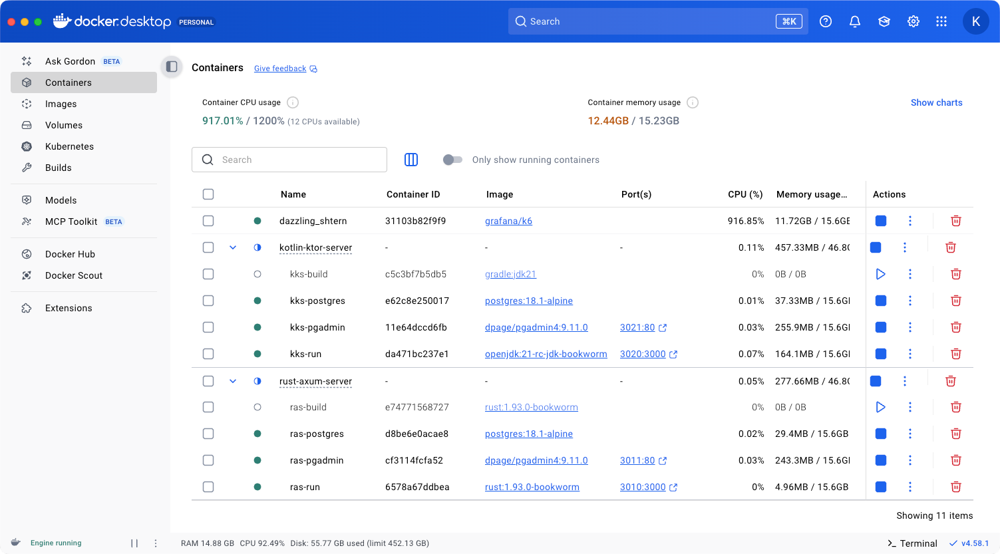

# Check performance

Language and frameworks REST API performance test.


### Frameworks

- Ktor (kotlin)
- Axum (rust)

### Reports

Reports in the form of HTML pages can be found in the project repository: [reports](reports).

### Run servers and tests

> Docker must be installed on the system.

```shell
./scripts/run_all.sh
```


